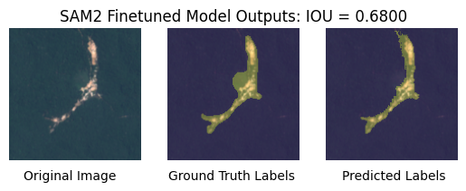

# TORTOISE -  Terrain Observation for Remote Tracking of Illegal Sand Extraction

This project does **fine grained segmentation of artisinal gold mines** from satellite images of the Amazon rainforest. It contains a trained [SAM2](https://github.com/facebookresearch/sam2) segmentation model and notebooks for inference, and code to train SAM2 and U-Net models for segmentation. It takes in Sentinel-2 rgb data as input and outputs a segmentation mask that shows where it thinks illegal mines are. It is currently designed to be used on map tiles containing probable mines generated from Earth Genome's [Gold Mine Detector](https://github.com/earthrise-media/mining-detector).

<figure>
    
    <figcaption>A median accuracy output for our model overlayed onto a gold mine.</figcaption>
</figure>


## Generating Mining Masks with the SAM2 Model
To run inference (generate labels/masks for mines):
1. Download the trained SAM2 model [here](https://drive.google.com/file/d/1xJJroc2gxaaRAsTBMwGt2_Y9ywa4ZRFw/view?usp=sharing).
2. Set up your data with the following folder structure: 
```
root
│
└───training_images_RGBs
│   │   image000.png
│   │   image001.png
│   │   ...
│   
└───training_images_masked
    │   image000.tif
    │   image001.tif
    |   ...
```
For this step, training_images_RGBs will be each map tile you want to detect as an RGB png in order. These images will be used directly by the model to generate our masks. 

The training_images_masked folder is optional will contain Senteniel2 .tif images corresponding to each of the images in training_images_RGBs with a [datamask](https://docs.sentinel-hub.com/api/latest/user-guides/datamask/) applied to the image. This datamask tells us which pixels are valid to even try to make labels for in case you have some prior for where mining is from using an object detection model. If USE_MASKS is False, then we will consider all pixels valid.

3. Run the SAM2_Mining_Detector_Inference.ipynb notebook in Colab. (Colab is optional but easier. We used a T4 GPU for inference.)
4. Change the following lines to the root directory from Step 2 and the path for your model you downloaded in Step 1. If using a training_images_masked folder, change USE_MASKS to True.
```python
ROOT_IMAGE_FOLDER = "/content/drive/MyDrive/GeoCompassSegmentations"
MODEL_DIRECTORY = ROOT_IMAGE_FOLDER + "/Colab_Notebooks/models/SAM_model_96_px_final.pth"
USE_MASKS=False
```
5. Run the  SAM2_Mining_Detector_Inference.ipynb notebook from start to finish. Write code to save the results in the format of your choosing at the end.

## Training the Model

## Repo Layout
- `src/tortoise/` – core code: datasets/dataloaders, augmentations, U-Net family (`U_Net`, `AttU_Net`, etc.), training loop, metrics/inference utilities.
- `configs/` – `config.yml` (tiling params), `hyperparams.yml` (model/optimizer/dataset settings).
- `scripts/` – data prep: `data_organize.py`, `tilify.py`, `tearify.py`.
- `notebooks/` – SAM2 finetuning notebooks and miscellaneous exploratory work

## Setup
```bash
conda env create -f environment.yml
conda activate tortoise
# Point code to the repo root (needed by scripts/utils)
# Linux/macOS: export PROJECT_ROOT=$(pwd)
# Windows PS:  $env:PROJECT_ROOT = (Get-Location).Path
```

## Data Preparation
Assumes raw files under `data/raw/`:
- Multispectral: `data/raw/training_images_masked/`
- Labels: `data/raw/segmentations_masked/`
- RGB: `data/raw/training_images_RGBs/`

You must run these three scripts in order before using the dataset:

1. **`data_organize`** – Organizes raw data files into the required directory structure
```bash
python scripts/data_organize.py
```
2. **`tilify`** – Processes the organized data and generates `tile_index.csv` and `meta.json`
```bash
python scripts/tilify.py
```
3. **`tearify`** - Uses `tile_index.csv` to extract the tiles and store in file system
```bash
python scripts/tearify.py
```

**The dataset will not load if these preprocessing steps are skipped.** The `tile_index.csv` file is required for the dataset to function.

## After Preprocessing

Once preprocessing is complete, you can load the dataset: using `TileDataSet` and `DataLoader` . This processes is demonstrated in `notebooks/example_dataloader.ipynb`. 

## U-Net

U-Net models are adapted from [attention_unet by sfczekalski](https://github.com/sfczekalski/attention_unet). There are two major changes.
- Parameterization of base channel width, depth, and growth factor (scaling factor that scales up number of channel)
- Randomized spatial dropout inside each convolutional block

Training example for U-Net is shown in `notebooks/example_U-Net_training.ipynb`

## Training SAM2
Save the imageset directory, a zip file of all of the generated tiles, and tile_index.csv from the preprocessing steps to a data directory. Run SAM2FinetuneNew.ipynb to finetune the data based on the tiled data in the data directory.

# TORTOISE

## SAM 2 Notebooks

Code for training a finetuned SAM2 model is in the notebooks/ folder. 
* SAM2FinetuneNew finetunes a SAM2 model.
* SAM2FT_Validate calculates performance metrics based off of generated finetuned models using a tiling approach.
* DL_Zero_Shot calculates performance metrics based off of generated finetuned models using full images, without tiling.
* SAM2MiningDetectorInference is for running inference with a trained model and generating mine labels.

## Evaluation / Inference
- Tile-wise evaluation: `tortoise.train.evaluate(...)`
- Whole-image fusion + metrics: `tortoise.utils.ensemble_image` and `evaluate_images`
- Visualization helpers: `tortoise.utils.to_display_rgb`
